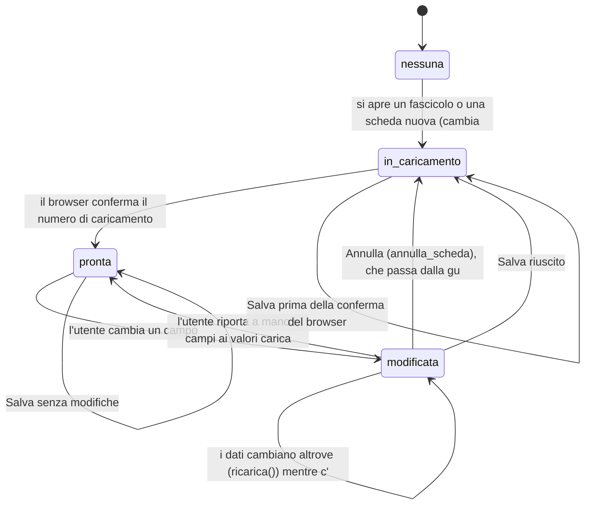
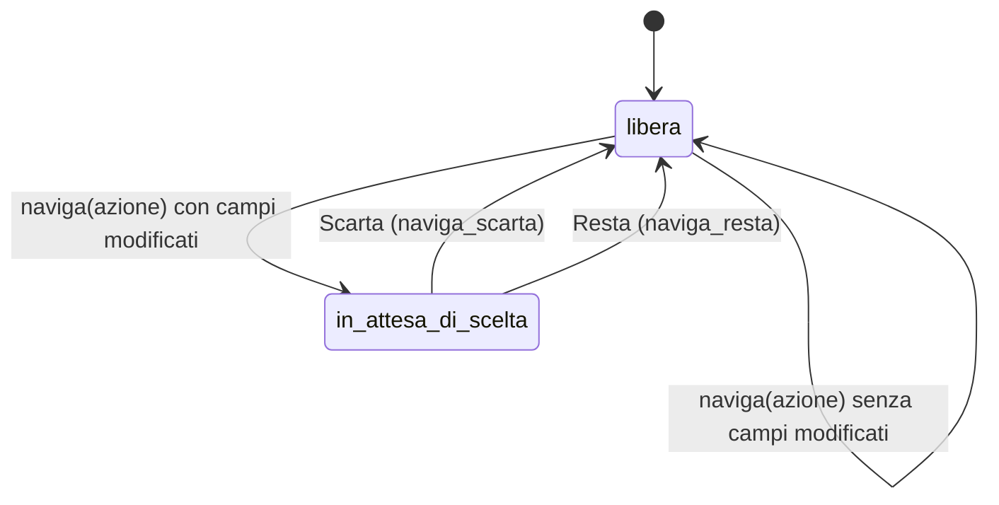
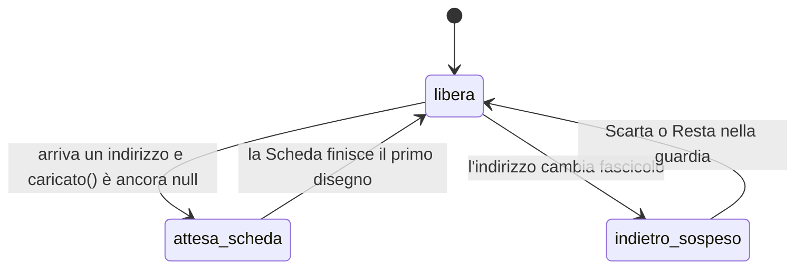
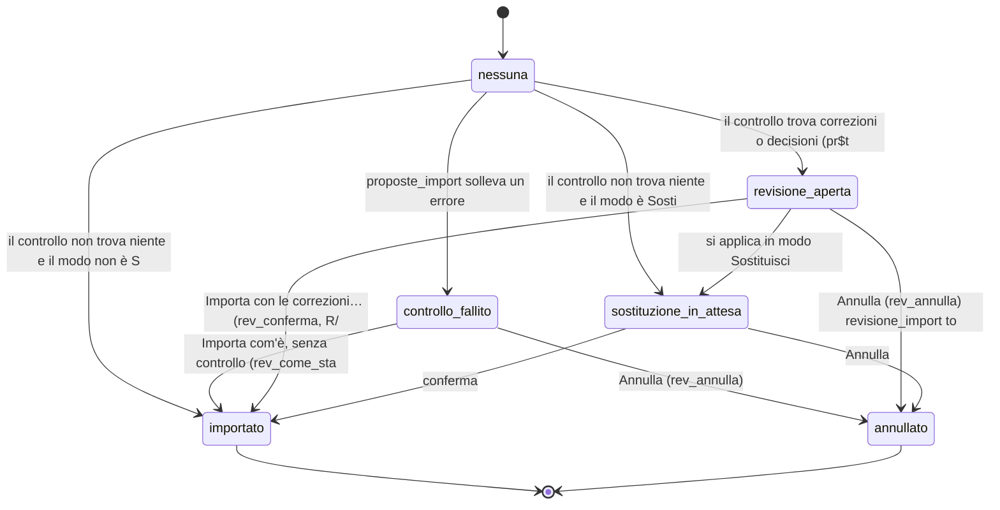
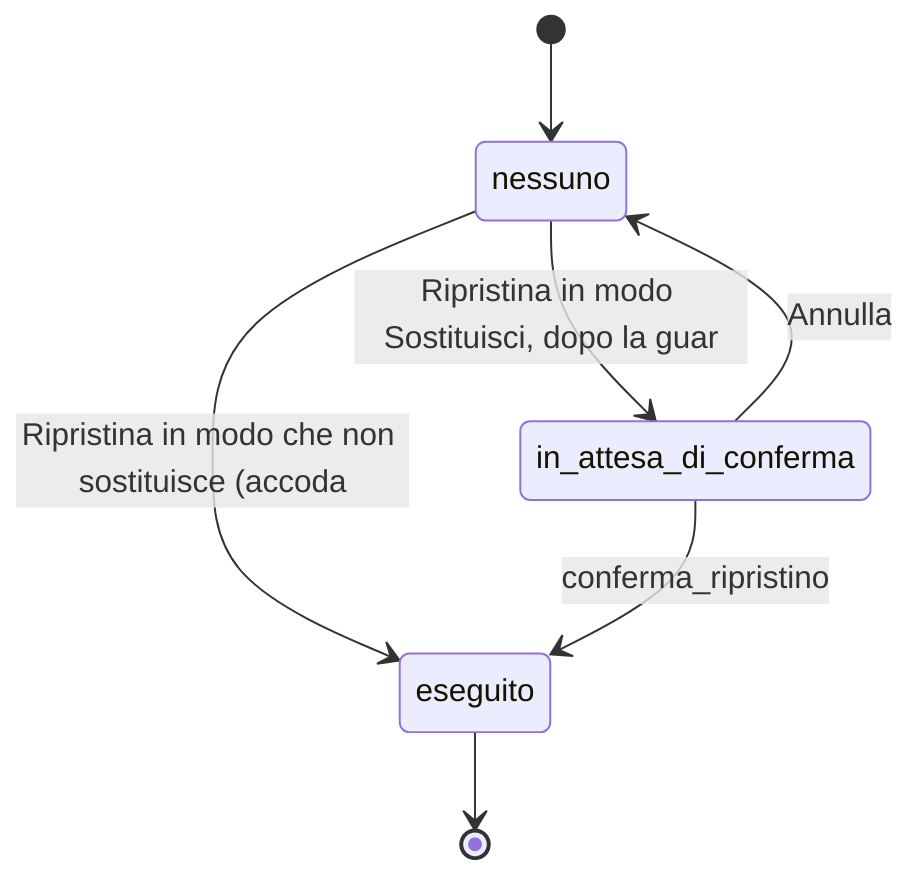
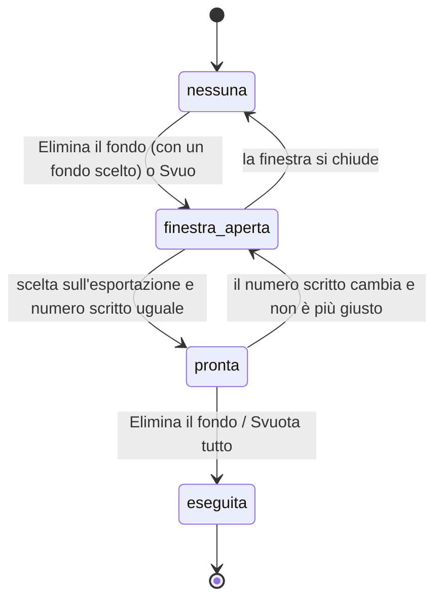
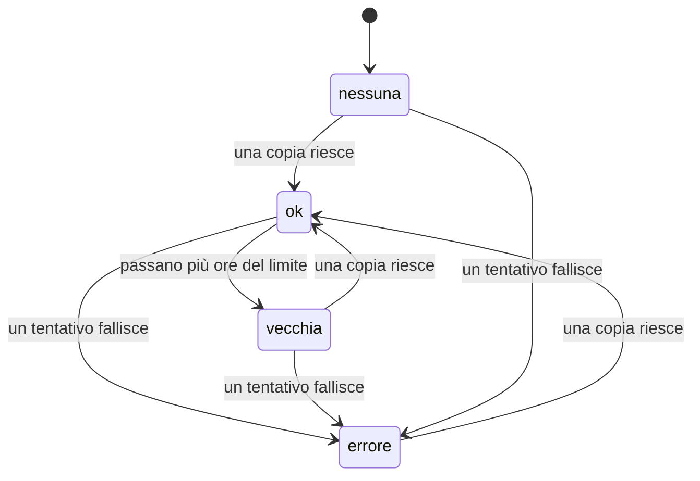

# Le macchine a stati dell'app

*Generato da `docs/stati.json` con `TRAMA_STATI_SALVA=1 Rscript verifiche/stati.R`: non si modifica a mano. Si cambia il JSON, si rigenera.*

Un'app Shiny non ha un posto dove dire «questo è uno stato»: gli stati vivono in combinazioni di variabili reattive. Qui sono scritti una volta sola,
con gli stati, le transizioni, le promesse che non devono rompersi (gli **invarianti**) e il collaudo che le protegge. `verifiche/stati.R` controlla che
i nomi nel codice esistano ancora e che il grafo sia coerente.

Prima di cambiare una di queste parti dell'app: leggi la macchina, scrivi quale transizione cambia, tieni veri gli invarianti.

Lo stesso schema («azione sospesa → finestra → conferma o annulla») ricorre in Importa, Ripristino, Cancellazione e nella guardia delle modifiche: 
la variabile che tiene l'azione sospesa è sempre `NULL` quando non c'è nulla in attesa, e ogni via d'uscita della finestra la rimette a `NULL`.

| Macchina | Dove | Collaudo | Lacune |
|---|---|---|---|
| [La Scheda aperta: dal caricamento al Salva](#scheda_aperta) | `R/modulo_server.R` | `browser/verifica-clic-anticipato.spec.js`, `salvataggio_neutro.R`, `browser/verifica-stati-guardie.spec.js`, `browser/verifica-bozza-conservata.spec.js` | 0 |
| [Modifiche non salvate: la guardia che precede ogni spostamento](#guardia_modifiche) | `R/modifiche_server.R` | `browser/verifica-scheda-grafica.spec.js`, `browser/verifica-stati-guardie.spec.js` | 0 |
| [Indietro e indirizzo: la cronologia del browser sulla Scheda](#cronologia) | `R/cronologia.R` | `browser/verifica-stati-guardie.spec.js` | 1 |
| [Importa: dal foglio letto all'import scritto](#import) | `R/import_server.R`, `R/revisione_server.R` | `interfaccia.R`, `sicurezza_json.R`, `browser/verifica-importa-esporta.spec.js`, `normalizzazione_prova.R` | 0 |
| [Ripristino da una copia di sicurezza](#ripristino) | `R/ripristino_server.R` | `ripristino_interfaccia.R`, `browser/verifica-ripristino.spec.js` | 0 |
| [Elimina un fondo / Svuota tutto](#cancellazione) | `R/gestione.R` | `database.R`, `browser/verifica-stati-guardie.spec.js`, `browser/verifica-cancellazione-completa.spec.js` | 1 |
| [La striscia delle copie di sicurezza](#copia_di_sicurezza) | `R/backup.R`, `R/backup_server.R` | `backup_completo.R` | 0 |

## La Scheda aperta: dal caricamento al Salva

Variabili e funzioni che ne tengono lo stato: `R/modulo_server.R::caricato_per`, `R/modulo_server.R::numero_caricamento`, `R/modulo_server.R::caricati`, `R/modulo_server.R::dopo_salva`, `R/modulo_server.R::modulo_pronto`.

**Stati**

- `nessuna` *(iniziale)*: Nessun fascicolo aperto nel modulo.
- `in_caricamento`: Il server ha i valori del fascicolo, il browser non ha ancora confermato di averli messi nei campi (`input$caricato` diverso da `numero_caricamento`).
- `pronta`: Il browser ha confermato: i campi mostrano il fascicolo aperto e nessuno è cambiato.
- `modificata`: Almeno un campo è diverso dai valori caricati (`campi_modificati()` non vuoto): compare il pallino su Salva.

**Transizioni**

| Da | A | Quando | Effetto |
|---|---|---|---|
| `nessuna` | `in_caricamento` | si apre un fascicolo o una scheda nuova (cambia `aperto()` o `richiesta()`) | i campi si riempiono; `caricato_per` e `numero_caricamento` avanzano |
| `in_caricamento` | `pronta` | il browser conferma il numero di caricamento | `modulo_pronto()` diventa vero |
| `pronta` | `modificata` | l'utente cambia un campo | pallino su Salva; la navigazione passa dalla guardia (macchina guardia_modifiche) |
| `modificata` | `in_caricamento` | «Annulla» (`annulla_scheda`), che passa dalla guardia | `richiesta()` avanza: la scheda si ricarica dal database e le modifiche si perdono |
| `modificata` | `pronta` | l'utente riporta a mano i campi ai valori caricati | il pallino sparisce |
| `modificata` | `in_caricamento` | Salva riuscito | `dopo_salva` vero: la scheda si ricarica dal database e la conferma del browser rimette `pronta` |
| `modificata` | `modificata` | i dati cambiano altrove (`ricarica()`) mentre c'è una bozza | la bozza resta e un avviso lo dice; Salva poi controlla che la scheda non sia cambiata nel frattempo |
| `pronta` | `pronta` | Salva senza modifiche | nessuna scrittura, avviso «Nessuna modifica» |
| `in_caricamento` | `in_caricamento` | Salva prima della conferma del browser | nessuna scrittura, avviso «si sta ancora caricando» |

**Invarianti (non devono rompersi)**

- Salva scrive solo se `modulo_pronto()` è vero: i campi a schermo sono quelli del fascicolo selezionato, mai di quello precedente.
- Una bozza non viene mai sovrascritta da un ricaricamento che arriva da altrove.
- Salva su una scheda cambiata nel frattempo viene respinto, non fonde in silenzio.

**Collaudi**: 
`browser/verifica-clic-anticipato.spec.js`, `salvataggio_neutro.R`, `browser/verifica-stati-guardie.spec.js`, `browser/verifica-bozza-conservata.spec.js`

## Modifiche non salvate: la guardia che precede ogni spostamento

Variabili e funzioni che ne tengono lo stato: `R/modifiche_server.R::in_attesa`, `R/modifiche_server.R::naviga`.

**Stati**

- `libera` *(iniziale)*: Nessuna azione sospesa.
- `in_attesa_di_scelta`: Un'azione di spostamento (cambio scheda, cambio fondo, ripristino, Indietro…) è sospesa e una finestra chiede se scartare le modifiche.

**Transizioni**

| Da | A | Quando | Effetto |
|---|---|---|---|
| `libera` | `libera` | `naviga(azione)` senza campi modificati | l'azione parte subito |
| `libera` | `in_attesa_di_scelta` | `naviga(azione)` con campi modificati | l'azione è tenuta in `in_attesa`; finestra «Modifiche non salvate» con l'elenco dei campi |
| `in_attesa_di_scelta` | `libera` | «Scarta» (`naviga_scarta`) | la finestra si chiude e l'azione sospesa parte |
| `in_attesa_di_scelta` | `libera` | «Resta» (`naviga_resta`) | l'azione è abbandonata; il fondo mostrato nel menu torna quello in uso; la scheda resta com'è |

**Invarianti (non devono rompersi)**

- Nessuno spostamento perde modifiche senza passare di qui.
- «Resta» non lascia mai il menu del fondo su un valore diverso dal fondo in uso.

**Collaudi**: 
`browser/verifica-scheda-grafica.spec.js`, `browser/verifica-stati-guardie.spec.js`

## Indietro e indirizzo: la cronologia del browser sulla Scheda

Variabili e funzioni che ne tengono lo stato: `R/cronologia.R::da_indietro`, `R/cronologia.R::atteso`.

**Stati**

- `libera` *(iniziale)*: Nessun indirizzo in attesa e nessun «Indietro» sospeso. Tornare all'elenco dallo stesso fascicolo non passa dalla guardia e non perde la bozza: la scheda resta com'è e Avanti la ritrova.
- `attesa_scheda`: È arrivato un indirizzo mentre la Scheda non aveva ancora finito il primo disegno: `atteso` lo tiene.
- `indietro_sospeso`: Un «Indietro» che cambierebbe fascicolo passa dalla guardia e aspetta la scelta (`da_indietro` vero).

**Transizioni**

| Da | A | Quando | Effetto |
|---|---|---|---|
| `libera` | `attesa_scheda` | arriva un indirizzo e `caricato()` è ancora nullo | l'indirizzo è tenuto in `atteso` |
| `attesa_scheda` | `libera` | la Scheda finisce il primo disegno | l'indirizzo atteso viene eseguito |
| `libera` | `indietro_sospeso` | l'indirizzo cambia fascicolo | `da_indietro` vero e l'azione passa da `naviga` |
| `indietro_sospeso` | `libera` | «Scarta» o «Resta» nella guardia | con «Resta» il browser rimette l'indirizzo com'era (`posto_ripristina`) |

**Invarianti (non devono rompersi)**

- L'indirizzo mostrato dal browser è sempre quello del fascicolo aperto, anche dopo un «Resta».
- L'indirizzo d'avvio (`avvio`, `da`) non annulla mai un clic più recente: il client non lo manda se la barra è già stata toccata, il server lo scarta in `vai` se `input$nav` non è più la scheda che c'era all'invio.

**Collaudi**: 
`browser/verifica-stati-guardie.spec.js`

**Lacune**

- Provato: Indietro/Avanti verso l'elenco con una bozza. Non provato: Indietro che cambia fascicolo (serve una cronologia con due schede diverse: la cronologia sostituisce le voci fra schede, quindi dal solo elenco non si raggiunge) e l'indirizzo arrivato prima del primo disegno (`atteso`).

## Importa: dal foglio letto all'import scritto

Variabili e funzioni che ne tengono lo stato: `R/import_server.R::revisione_import`, `R/import_server.R::rev_selezione`, `R/revisione_server.R::conferma_revisione`, `R/import_server.R::import_sostituzione_in_attesa`, `R/import_server.R::esegui_import_vero`.

**Stati**

- `nessuna` *(iniziale)*: Nessun controllo in corso.
- `controllo_fallito`: Il controllo del foglio è andato in errore: `revisione_import` ha un risultato vuoto e la finestra dice «Il controllo non è riuscito».
- `revisione_aperta`: Il controllo ha trovato qualcosa: finestra con le correzioni (`rev_selezione` = quelle spuntate) e le decisioni.
- `sostituzione_in_attesa`: Modo «Sostituisci questo fondo»: l'import è pronto ma aspetta la conferma, perché cancella le schede del fondo (`import_sostituzione_in_attesa`).
- `importato` *(finale)*: Le righe sono scritte (o respinte, con l'elenco): fine.
- `annullato` *(finale)*: Nulla è stato scritto.

**Transizioni**

| Da | A | Quando | Effetto |
|---|---|---|---|
| `nessuna` | `controllo_fallito` | `proposte_import` solleva un errore | l'errore è registrato; nessuna scrittura |
| `nessuna` | `revisione_aperta` | il controllo trova correzioni o decisioni (`pr$totale > 0`) | le correzioni consigliate sono spuntate di partenza |
| `nessuna` | `importato` | il controllo non trova niente e il modo non è «Sostituisci» | import diretto |
| `nessuna` | `sostituzione_in_attesa` | il controllo non trova niente e il modo è «Sostituisci» | finestra «Sostituire tutte le schede?» con il numero di schede che spariscono |
| `controllo_fallito` | `annullato` | «Annulla» (`rev_annulla`) | niente scritto |
| `controllo_fallito` | `importato` | «Importa com'è, senza controllo» (`rev_come_sta`) | import senza correzioni |
| `revisione_aperta` | `importato` | «Importa con le correzioni…» (`rev_conferma`, R/revisione_server.R) | import con le correzioni; modo «Sostituisci» passa prima dalla conferma |
| `revisione_aperta` | `sostituzione_in_attesa` | si applica in modo «Sostituisci» | conferma prima di cancellare |
| `revisione_aperta` | `annullato` | «Annulla» (`rev_annulla`): `revisione_import` torna nullo | niente scritto |
| `sostituzione_in_attesa` | `importato` | conferma | copia di sicurezza, poi sostituzione |
| `sostituzione_in_attesa` | `annullato` | Annulla | niente scritto |

**Invarianti (non devono rompersi)**

- Un controllo che fallisce non scrive mai nulla da solo.
- «Sostituisci» non cancella senza una conferma esplicita e senza una copia di sicurezza prima.
- Senza fondo scelto «Sostituisci» non parte.

**Collaudi**: 
`interfaccia.R`, `sicurezza_json.R`, `browser/verifica-importa-esporta.spec.js`, `normalizzazione_prova.R`

## Ripristino da una copia di sicurezza

Variabili e funzioni che ne tengono lo stato: `R/ripristino_server.R::ripristino_in_attesa`, `R/ripristino_server.R::risultato_ripristino`.

**Stati**

- `nessuno` *(iniziale)*: Nessun ripristino in corso.
- `in_attesa_di_conferma`: Modo «Sostituisci»: file scelto, finestra «Sostituire i dati con il backup?» (`ripristino_in_attesa`).
- `eseguito` *(finale)*: Il risultato è mostrato nella carta (`risultato_ripristino`).

**Transizioni**

| Da | A | Quando | Effetto |
|---|---|---|---|
| `nessuno` | `in_attesa_di_conferma` | «Ripristina» in modo «Sostituisci», dopo la guardia delle modifiche non salvate | finestra di conferma |
| `nessuno` | `eseguito` | «Ripristina» in modo che non sostituisce (accoda) | ripristino diretto |
| `in_attesa_di_conferma` | `eseguito` | `conferma_ripristino` | prima una copia integrale del database attuale, poi il ripristino |
| `in_attesa_di_conferma` | `nessuno` | Annulla | niente scritto |

**Invarianti (non devono rompersi)**

- Il ripristino che sostituisce passa sempre da una conferma e da una copia del database attuale.
- Il file ripristinato non si legge senza essere stato scelto.

**Collaudi**: 
`ripristino_interfaccia.R`, `browser/verifica-ripristino.spec.js`

## Elimina un fondo / Svuota tutto

Variabili e funzioni che ne tengono lo stato: `R/gestione.R::canc`, `R/gestione.R::canc_pronto`, `R/gestione.R::finestra_cancella`.

**Stati**

- `nessuna` *(iniziale)*: Nessuna cancellazione aperta.
- `finestra_aperta`: La finestra mostra cosa sparirebbe (`canc` ha tipo, fondo, numero di schede); il pulsante è spento.
- `pronta`: `canc_pronto()`: l'utente ha scelto se ha esportato e ha scritto il numero esatto delle schede (o il fondo è vuoto).
- `eseguita` *(finale)*: Copia di sicurezza fatta, dati cancellati, elenco ricaricato.

**Transizioni**

| Da | A | Quando | Effetto |
|---|---|---|---|
| `nessuna` | `finestra_aperta` | «Elimina il fondo» (con un fondo scelto) o «Svuota tutto» | senza fondo scelto: avviso e nessuna finestra |
| `finestra_aperta` | `pronta` | scelta sull'esportazione e numero scritto uguale al numero di schede | il pulsante si accende |
| `pronta` | `finestra_aperta` | il numero scritto cambia e non è più giusto | il pulsante si spegne |
| `pronta` | `eseguita` | «Elimina il fondo» / «Svuota tutto» | `backup_prima_ripristino` PRIMA, poi `elimina_fondo` o `svuota_database`, riga nel registro, `canc(NULL)` |
| `finestra_aperta` | `nessuna` | la finestra si chiude | niente scritto |

**Invarianti (non devono rompersi)**

- Si cancella solo da `pronta`; premere il pulsante in altro stato avvisa e non scrive.
- La copia di sicurezza è fatta prima della cancellazione; se la copia fallisce, non si cancella.

**Collaudi**: 
`database.R`, `browser/verifica-stati-guardie.spec.js`, `browser/verifica-cancellazione-completa.spec.js`

**Lacune**

- «Svuota tutto» è provato solo con «Tieni le impostazioni» acceso; senza, `svuota_database` è provato solo sulla funzione (`database.R`).

## La striscia delle copie di sicurezza

Variabili e funzioni che ne tengono lo stato: `R/backup.R::stato_backup`, `R/backup_server.R::backup_errore`, `R/backup_server.R::backup_versione`.

**Stati**

- `errore`: L'ultimo tentativo non è riuscito: la striscia lo dice in rosso finché una copia non va a buon fine.
- `nessuna` *(iniziale)*: Nessuna copia nella cartella dei backup.
- `vecchia`: L'ultima copia è più vecchia del limite di ore.
- `ok`: C'è una copia recente.

**Transizioni**

| Da | A | Quando | Effetto |
|---|---|---|---|
| `nessuna` | `ok` | una copia riesce | la striscia mostra «Ultima copia … fa» |
| `ok` | `vecchia` | passano più ore del limite | avviso «È passato troppo tempo» |
| `vecchia` | `ok` | una copia riesce | avviso tolto |
| `ok` | `errore` | un tentativo fallisce | il motivo compare in rosso |
| `vecchia` | `errore` | un tentativo fallisce | il motivo compare in rosso |
| `nessuna` | `errore` | un tentativo fallisce | il motivo compare in rosso |
| `errore` | `ok` | una copia riesce | il rosso sparisce |

**Invarianti (non devono rompersi)**

- Precedenza fissa in `stato_backup`: errore, poi nessuna, poi vecchia, poi ok. Un errore non si nasconde dietro una copia vecchia.
- È una funzione pura dello stato della cartella e dell'ultimo errore: lo stesso ingresso dà sempre lo stesso livello.

**Collaudi**: 
`backup_completo.R`
